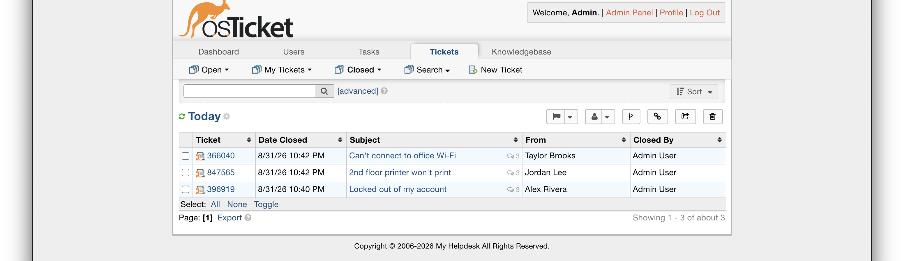

# Helpdesk Lab

> Part of my [IT & Cybersecurity Portfolio](https://github.com/owenncampbell/it-cybersecurity-portfolio)

A simulated helpdesk environment built to practice and demonstrate the core IT support workflow of taking a ticket, triaging it, working it to resolution, and documenting it clearly. This project includes a real, running ticketing system (osTicket in Docker), not just documentation.

## What this demonstrates

- **Ticket triage & categorization** — 4 departments and 4 help topics, each mapped to a specific escalation path. See [`ticketing-system/categories.md`](ticketing-system/categories.md).
- **Troubleshooting methodology** — 4 runbooks covering the most common Tier 1 ticket types, each following the same plan: triage questions → diagnostic steps → resolution → escalation criteria. See [`runbooks/`](runbooks/).
- **Real ticket handling** — 4 worked example tickets with internal triage notes and customer-facing replies, one left open intentionally to show a realistic in-progress queue. See [`ticketing-system/example-tickets.md`](ticketing-system/example-tickets.md).

## Setup

osTicket runs as a Docker Compose stack (osTicket + MySQL) on [Colima](https://github.com/abiosoft/colima), a lightweight container runtime for macOS. See [`ticketing-system/`](ticketing-system/) for the setup notes.

## Why this design

- **Ticketing system** gives real experience with intake, categorization, prioritization, and closing tickets — the core workflow of any helpdesk role.
- **Troubleshooting runbooks** turn general IT support knowledge into a repeatable process, then get refined against real worked tickets.

## Build log

| Date | Component | Status | Notes |
|---|---|---|---|
| 2026-08-31 | Ticketing system install (Docker) | Running | Real osTicket instance via Docker Compose — see [`ticketing-system/`](ticketing-system/) |

## Contents

- [`ticketing-system/`](ticketing-system/) — setup notes for the self-hosted ticketing system, ticket categorization, and worked example tickets
- [`runbooks/`](runbooks/) — troubleshooting runbooks for common ticket types

## Tools

- Ticketing: [osTicket](https://osticket.com/), self-hosted (running — see [`ticketing-system/`](ticketing-system/))
- Container runtime: Docker Compose on [Colima](https://github.com/abiosoft/colima) (macOS)
